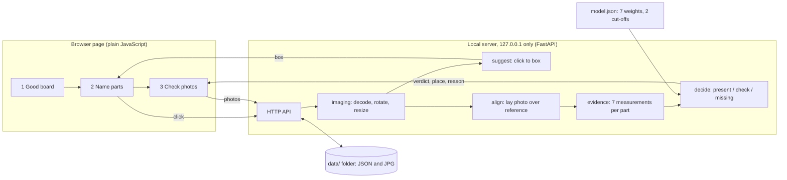

# Architecture

<!-- TODO before submitting: the brief asks for a diagram made with Archify.
     Put its export at docs/architecture.png and replace the Mermaid block below. -->

Everything inside both boxes runs on one laptop. There is no other service.

## What happens to one photo

1. **Decode** (`imaging.py`). Apply the phone's rotation tag, flatten transparency, cap the size. Unreadable files get a plain message.
2. **Align** (`align.py`). Propose up to four alignments (as taken, feature match, feature match near the parts, fine-tuned), score each on the board right around the named parts, keep the best. Then remove small local bends. If the best score is below 0.30 the photo is refused, not judged.
3. **Measure** (`evidence.py`). For each named part: shape, edges, the same two on the part's core, colour, outline, and whether the box now looks like bare board. The structural ones are divided by this photo's own noise floor, measured on board that should not have changed.
4. **Decide** (`decide.py`). A logistic regression over those seven numbers gives 0 to 1. Two cut-offs make three answers: in place, check by eye, missing.
5. **Show** (`static/app.js`). The boxes are mapped back on to the uploaded photo. A close call shows both crops side by side and the operator decides.

## Trade-offs

| I chose | I gave up | Why |
|---|---|---|
| Compare with one reference photo | Learning what each part type looks like | The demo board is unseen and there is one good photo of it. There is nothing to train on. |
| Measurements plus a 7-weight model | A neural network's tolerance of odd textures | Runs in well under a second on a CPU, no weights to ship, and every verdict can be explained. A network (DINOv2) was considered but **not measured**; see RESEARCH.md. |
| Noise floor per photo | Fixed thresholds that are easier to reason about | The same difference is damning in a clean photo and ordinary in a blurred one. |
| Three answers | The brief's simpler OK / missing | A wrong OK ships a bad board. An honest "look here" costs a glance. OK is only green when nothing is missing and nothing is in doubt. |
| Refuse photos that do not line up | Always giving an answer | Judging the wrong board produces confident nonsense. |
| Only named parts are checked | Finding any other damage | That is what the brief asks for. An unnamed part can go missing without a word. |
| Local web page | A native desktop app | Same page on Mac, Windows and Linux, nothing to compile. The cost is a terminal window that has to stay open. |
| Files in `data/` | A database | Nothing to install, and a board can be copied by copying its folder. It would not suit many stations writing at once. |
| Plain JavaScript | A framework | No build step and no packages to fetch, so nothing can break offline. |

## Where it will fail

- A part nearly the same colour as the board, with its pads left behind, in poor light. The app warns while you name such a part ("Faint", "Hard to see").
- A perfectly plain board on which every named part is missing. There is nothing left to align to, so the photo is refused.
- A part swapped for a similar one, or fitted backwards. That is a different job from "missing".
- A camera moved far enough to see the sides of tall parts. The brief says the camera is fixed.

## Safety of the local server

It listens on 127.0.0.1 only and rejects any other Host header, so another website cannot talk to it. A content security policy lets the page load from this server and nowhere else. Board ids are checked before they become paths. Uploads are capped at 40 MB and 80 megapixels.
