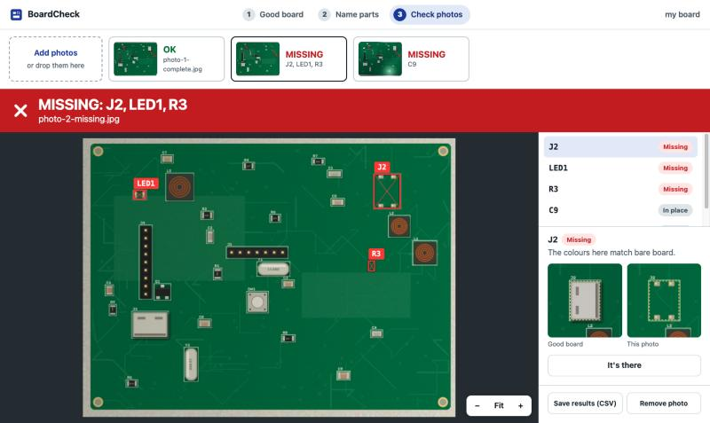
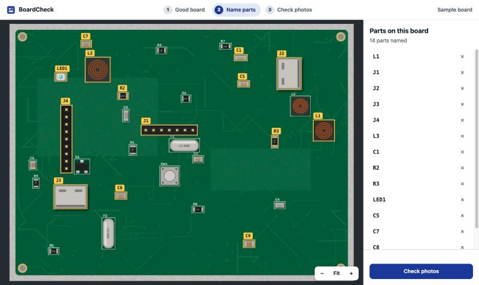
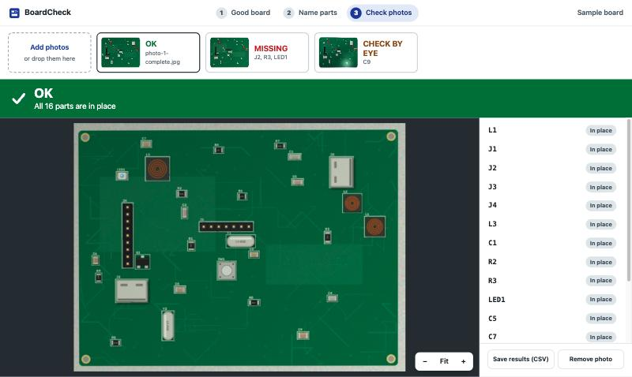

# BoardCheck: which part is missing?

Task B. Upload one photo of a good circuit board, name its parts once, then drop
in photos of the same board. Each photo comes back as **OK** in green, or with the
missing parts named and marked. Runs entirely on your own laptop.



| Naming parts | A complete board |
|---|---|
|  |  |

## Install and run

You need Python 3.12 or newer. The first run needs internet once, to install
packages. After that it works with the network off.

Mac or Linux:

```bash
./run.sh
```

Windows: double-click `run.bat`.

The page opens at <http://127.0.0.1:8321>. Keep the terminal window open while you
use it. If macOS asks whether Terminal may read the folder, allow it.

By hand, if you prefer:

```bash
python3 -m venv .venv && .venv/bin/pip install -r requirements.txt && .venv/bin/python -m boardcheck
```

No internet at all on that computer? Build a zip that carries its packages, on a
computer of the same kind that does have internet, and copy it across. `run.sh` or
`run.bat` inside it then installs with the network off (Python 3.12 or 3.13):

```bash
python3 tools/bundle.py
```

## Use it

1. **Good board.** Drop in a photo with every part fitted. Or click *Try the sample board*.
2. **Name parts.** Click a part and a box appears around it; type its name. Or drag a box yourself. Boxes move and resize, names are saved as you go.
3. **Check photos.** Drop in one photo or many.

| Result | Meaning |
|---|---|
| **OK** (green) | Every named part is in place. |
| **MISSING** (red) | The named parts are gone. Each is crossed out on the photo. |
| **CHECK BY EYE** (amber) | The app is not certain. It shows both crops and you decide. |
| **CAN'T CHECK** (grey) | The photo does not line up with the good board. |

Photos can be JPG, PNG, WebP or iPhone HEIC. They may differ a little in position,
light and size. Good practice: same camera, whole board in frame, in focus.

## How well it works

On 480 test photos of 60 boards never used for tuning, under four kinds of camera and light drift:

- **436** photos (90.8%) were answered exactly right.
- **42** (8.8%) were right but asked the operator to look at one or more parts.
- **2** (0.4%) contained a wrong answer: one missing part called present, one present part called missing.

Each photo takes about 0.4 seconds on an M2 Pro.

All of this was measured on drawn boards, not real photographs. See
[RESEARCH.md](RESEARCH.md) for the comparison and its limits.

## More

- [ARCHITECTURE.md](ARCHITECTURE.md): how it works and the trade-offs
- [RESEARCH.md](RESEARCH.md): what was compared and why this was chosen
- [AI_COLLAB.md](AI_COLLAB.md): how the AI was used; the full chat is in [chat/](chat/)

Run the tests (about 30 seconds). They include a full check with every connection
outside this computer blocked:

```bash
.venv/bin/python -m unittest
```

Every push runs [these checks](.github/workflows/ci.yml): the tests on Linux, macOS and
Windows, a first run on a clean machine of each, and an install and check with the
network cut. The same start-to-finish check on your own machine:

```bash
.venv/bin/python tests/smoke.py
```

Repeat the benchmark (about 15 minutes):

```bash
.venv/bin/pip install -r requirements-bench.txt && .venv/bin/python -m bench.dataset train dev test && .venv/bin/python -m bench.fit test
```
